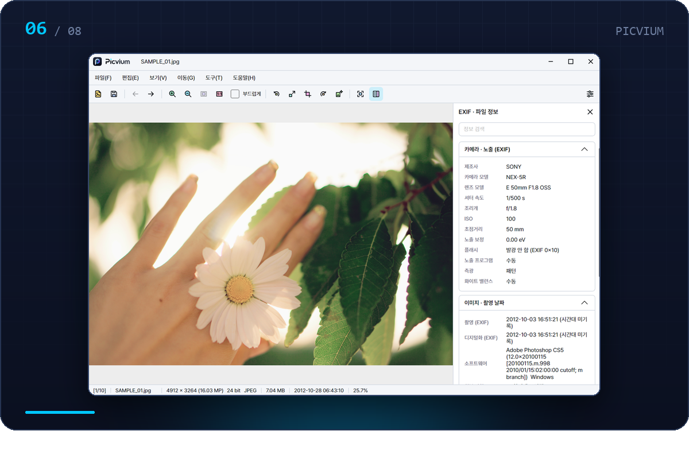
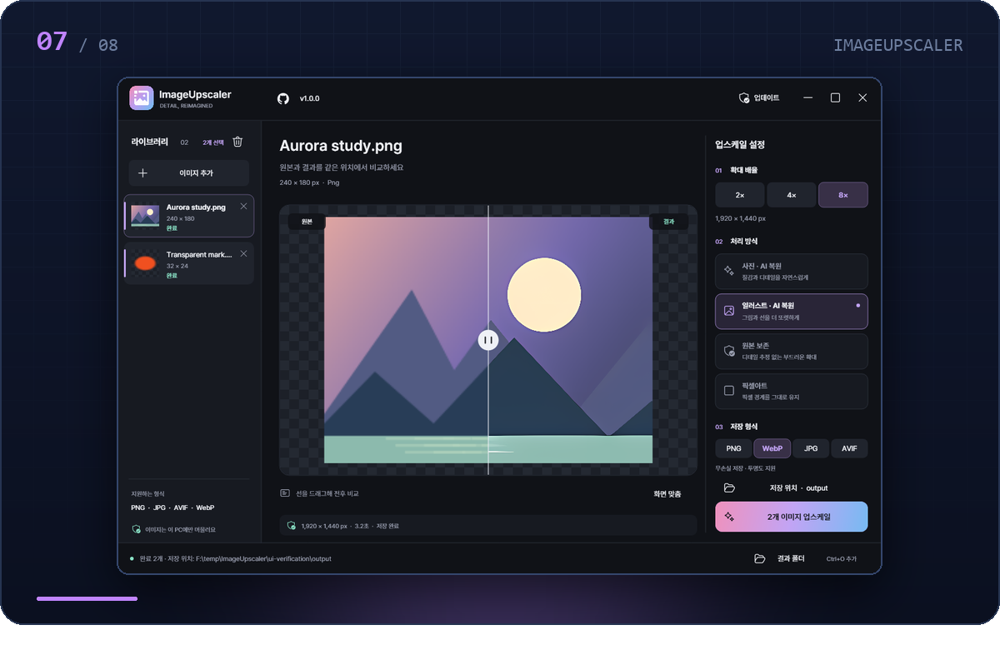
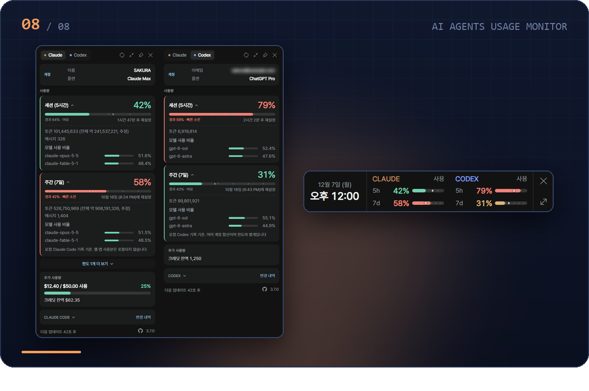
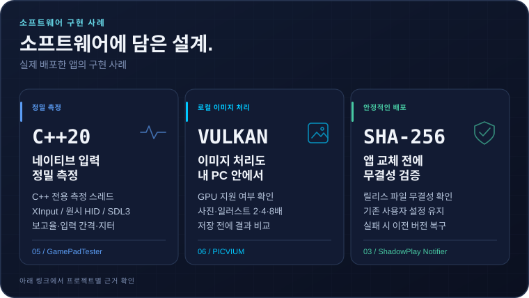
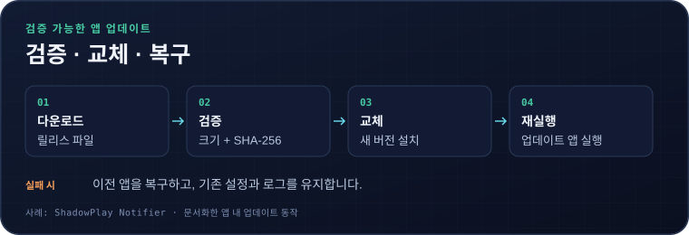

  
  

<picture>
  <source media="(max-width: 640px)" srcset="assets/hero-compact.svg">
  
</picture>

 

  <a href="#about"><b>소개</b></a> &nbsp;·&nbsp;
  <a href="#software"><b>프&#8288;로&#8288;젝&#8288;트</b></a> &nbsp;·&nbsp;
  <a href="#toolbox"><b>기술</b></a> &nbsp;·&nbsp;
  <a href="#insights"><b>활&#8288;동&nbsp;통&#8288;계</b></a> &nbsp;·&nbsp;
  <a href="#releases"><b>릴&#8288;리&#8288;스</b></a> &nbsp;·&nbsp;
  <a href="#engineering"><b>구&#8288;현&nbsp;사&#8288;례</b></a> &nbsp;·&nbsp;
  <a href="#connect"><b>연락</b></a>

## 02 · 소개

안정적인 기능, 세심한 인터페이스, 일상에서의 사용성을 중심으로 실용적인 데스크톱 애플리케이션과 개발자 유틸리티를 만듭니다.

앱의 설계부터 구현, 디버깅, 배포, 유지보수까지 독립적으로 진행합니다. 2025년 8월부터 영상 다운로더, 컨트롤러 화면용 GIF 도구, 하드웨어 진단, 이미지 뷰어·편집기, 업스케일러, 트레이 유틸리티 등 Windows 앱 8개를 배포했습니다. 각 앱에는 GitHub Releases 배포본, 프로젝트 사이트, 변경 기록이 있습니다.

| 원&#8288;칙 | 소프트웨어에 반영한 방식 |
|:--|:--|
| **사&#8288;용&#8288;성** | 적절한 기본값, 드래그 앤 드롭 입력, 다국어 인터페이스(최대 13개 언어) |
| **안&#8288;정&#8288;성** | SHA-256 검증과 복구 기능을 갖춘 앱 내 업데이트, 실패를 숨기지 않고 알려 주는 오류 처리 |
| **성&#8288;능** | NVENC·Vulkan GPU 처리, 폴링 레이트 측정용 C++ 전용 스레드, 기록 검색을 1,143 ms에서 56 ms로 줄인 측정 기반 개선 |
| **유&#8288;지&#8288;보&#8288;수** | 설정과 백업 파일을 문서화한 포터블 앱, 프로젝트별 변경 기록 |
| **지&#8288;속&#8288;개&#8288;선** | 실제 사용과 이슈 제보를 반영한 작은 단위의 잦은 배포. 아래 [릴리스 활동](#insights)에서 확인할 수 있습니다. |

## 03 · 주요 소프트웨어

우선순위에 따라 번호를 붙인 Windows 앱 8개입니다. 7개는 무료로 배포하는 소스 비공개 앱으로, 저장소에는 문서·변경 기록·배포 파일을 공개합니다. 나머지 1개는 MIT 라이선스의 오픈소스 포크입니다.

### 01 · TVer Downloader

**일본 TVer 스트리밍 서비스를 위한 Windows 다운로더**

yt-dlp와 FFmpeg로 TVer 에피소드와 YouTube 영상을 저장하는 PyQt6 앱입니다. 이어받기와 시리즈 단위 처리를 지원하는 다운로드 대기열을 중심으로 구성했습니다.

- 단일 URL·여러 URL·시리즈 전체 다운로드, 동시 작업 1–20개와 영상 조각 병렬 다운로드
- yt-dlp·FFmpeg 최신 버전 유지, NVIDIA NVENC를 이용한 AVC / HEVC 재인코딩 옵션
- 일본어 자막 내장 또는 VTT / SRT 저장, 즐겨찾기·기록·트레이 진행률
- 네트워크 변경 시 지역 확인 재실행, 재시작 없이 전환하는 7개 UI 언어

<b>기술</b>&nbsp; `Python` `PyQt6` `yt-dlp` `FFmpeg` `NVENC` 
<b>배포</b>&nbsp; 프리웨어 · Windows 10/11 x64 · 소스 비공개 
<b>최신 버전</b>&nbsp; 

  

 

### 02 · ChzzkDownloader

**치지직을 중심으로 여러 사이트를 지원하는 영상 다운로더**

치지직 VOD·클립과 YouTube, Instagram, TVer 등 지원 사이트의 영상을 MP4로 저장합니다. 치지직은 채널별 탐색 화면에서 영상을 골라 받을 수 있습니다.

- 동시 영상 4개·영상 조각 16개를 처리하는 일괄 대기열, 재실행 후 작업 복원
- 썸네일로 탐색하는 채널 즐겨찾기, 연결한 계정의 팔로우 채널 가져오기
- 암호화한 로컬 쿠키 저장과 여러 프로필 지원. 아이디·비밀번호 입력 없이 계정 연결
- 기본값은 원본 유지, CPU / NVENC H.264·H.265 변환 옵션과 SHA-256 검증 업데이트

<b>기술</b>&nbsp; `Python` `PySide6` `yt-dlp` `FFmpeg` `NVENC` 
<b>배포</b>&nbsp; 개인·비상업용 무료 · Windows 10/11 x64 · 소스 비공개 
<b>최신 버전</b>&nbsp; 

  

 

### 03 · ShadowPlay Notifier

**보조 모니터에 크게 표시하는 녹화 상태**

NVIDIA ShadowPlay 녹화 상태를 보조 모니터에 큰 글자로 표시합니다. 대기 중에는 시계·날씨·재생 중인 음악을 보여 주는 월페이퍼 화면으로 바뀝니다.

- 녹화 폴더의 파일 증가와 쓰기 핸들로 녹화를 감지. 녹화 프로그램에 개입하지 않는 읽기 전용 방식
- 경과 시간·파일 크기·비트레이트·파일 이름 표시, 기본 폴링 주기 0.5초 이내 갱신
- 시계, Open-Meteo 날씨, Spotify 음악, 24밴드 오디오 시각화, 달 위상을 표시하는 대기 화면
- 포터블 EXE 하나로 실행, 트레이에 숨긴 동안 렌더링 중단, SHA-256 검증 앱 내 업데이트

<b>기술</b>&nbsp; `Python` `Tkinter` `PyInstaller` `Open-Meteo` 
<b>배포</b>&nbsp; 프리웨어 · Windows 10/11 · 소스 비공개 
<b>최신 버전</b>&nbsp; 

  

 

### 04 · APEX GIF MAKER

**Flydigi APEX 컨트롤러 화면을 위한 MP4-to-GIF 도구**

영상의 원하는 순간을 APEX 4·5·6 등 Flydigi APEX 시리즈 컨트롤러의 내장 화면 크기에 맞는 GIF로 만듭니다. 모든 처리는 로컬 PC에서 이루어집니다.

- 트림 핸들, 확대 가능한 타임라인, 시간 직접 입력으로 정밀한 구간 선택
- 기본 출력 160×80·12 fps, 채우기·레터박스·늘리기와 자르기 미리보기
- 적응형 팔레트·디더링, 균일 프레임 또는 중복 프레임 제거 모드 등 GIF 품질 옵션
- FFmpeg 자동 관리, SHA-256 검증 업데이트, 6개 UI 언어와 다크 / 라이트 테마

<b>기술</b>&nbsp; `Python` `PySide6` `FFmpeg` 
<b>배포</b>&nbsp; 프리웨어 · Windows 10/11 x64 · 소스 비공개 
<b>최신 버전</b>&nbsp; 

  

 

### 05 · GamePadTester

**Windows용 정밀 게임패드 진단 도구**

gamepad-tester.com·Gamepadla와 같은 방식으로 스틱 원형도와 폴링 레이트를 측정해 결과를 직접 비교할 수 있습니다. 버튼·트리거·진동·자이로·터치패드도 확인합니다.

- 강제 데드존 없이 원시 값으로 스틱 원형도(32구간 RMS 오차)·드리프트·해상도·스냅백 측정
- C++ 전용 스레드에서 XInput 패킷·원시 HID 보고서·SDL로 폴링 레이트 측정, JSON / CSV / TXT 내보내기
- 컨트롤러 최대 4개, Xbox·DualSense·Switch Pro / ProCon 2 레이아웃, 적응형 트리거·진동 테스트
- DualSense USB 1000 Hz 폴링 설정, 800×400 결과 카드, SHA-256 검증 업데이트

<b>기술</b>&nbsp; `Python` `PySide6` `C++20` `SDL3` `XInput` `HID` 
<b>배포</b>&nbsp; 프리웨어 · Windows 10/11 · 소스 비공개 
<b>최신 버전</b>&nbsp; 

  

 

### 06 · PICVIUM

**RAW 보기와 로컬 업스케일을 지원하는 이미지 뷰어·편집기**

사진·그래픽·카메라 RAW·문서 이미지를 한 창에서 보고, 로컬 편집·형식 변환·Real-ESRGAN 업스케일을 처리합니다. Windows 배포본에 .NET 런타임을 포함하며 포터블 설정을 지원합니다.

- 폴더 썸네일, 확대·축소·이동, 애니메이션 재생, 여러 페이지 이동, EXIF 사이드바
- 자르기·크기 변경·회전·반전과 실행 취소 / 다시 실행, 7개 이미지 형식 저장·일괄 변환
- Vulkan GPU에서 사진·일러스트 2×·4×·8× 업스케일, 취소와 결과 비교
- 도구 모음·아이콘 테마 사용자 지정, 명령 검색, Windows 파일 연결, 재시작 없이 전환하는 9개 UI 언어

<b>기술</b>&nbsp; `C#` `.NET 10` `Avalonia 12` `Magick.NET` `LibRaw` `PDFium` `Real-ESRGAN / Vulkan` 
<b>배포</b>&nbsp; 개인·비상업용 무료 · Windows 10/11 x64 · 소스 비공개 
<b>최신 버전</b>&nbsp; 

  

 

### 07 · ImageUpscaler

**포터블·오프라인 AI 이미지 업스케일러**

사진·일러스트·투명 이미지·픽셀 아트를 로컬 PC에서 최대 8×로 확대합니다. 포터블 EXE 하나에 Real-ESRGAN 모델, 코덱, 런타임을 포함합니다.

- 사진 AI(Real-ESRGAN x4plus), 이미지 AI(x4plus-anime), 선형광 Lanczos, 픽셀 아트용 정수배 최근접 보간의 4가지 모드
- PNG·JPG·WebP·AVIF 2×·4×·8× 출력, 알파를 별도로 확대해 투명도 보존
- 일괄 처리 목록, 확대 가능한 전후 비교 슬라이더
- Vulkan 지원 여부 확인과 명시적인 대체 처리, SHA-256 검증 업데이트

<b>기술</b>&nbsp; `C#` `.NET 8` `Windows Forms` `SkiaSharp` `Magick.NET` `Real-ESRGAN (ncnn / Vulkan)` 
<b>배포</b>&nbsp; 무료 배포 · Windows 10/11 x64 · 소스 비공개 
<b>최신 버전</b>&nbsp; 

  

 

### 08 · AI Agents Usage Monitor

**Windows 트레이에서 확인하는 Claude·Codex 사용 한도**

Claude와 Codex 사용 한도를 실시간으로 보여 주는 가벼운 트레이 앱입니다. [jens-duttke/usage-monitor-for-claude](https://github.com/jens-duttke/usage-monitor-for-claude)를 확장한 포크로, Codex 지원·한 줄 바 모드·검증형 앱 내 업데이터를 추가했습니다.

- 세션·주간 한도를 표시하는 트레이 아이콘, 초기화 시각·플랜·크레딧·로컬 세션 기록의 모델별 토큰 상세 팝업
- 공식 Codex App Server로 조회한 Codex 한도를 Claude와 함께 표시
- 시계 옆 한 줄 바 모드, 시간 흐름을 반영한 사용량 색상, 임계값 알림
- 포터블 단일 EXE, 13개 언어, 이벤트 명령, 복구 기능을 갖춘 앱 내 업데이트

<b>기술</b>&nbsp; `Python` `pywebview` `pystray` `PyInstaller` `C#` 
<b>배포</b>&nbsp; 오픈소스(MIT) · jens-duttke/usage-monitor-for-claude의 포크 · Windows 10/11 x64 
<b>최신 버전</b>&nbsp; 

  

 

TVer, CHZZK, NVIDIA ShadowPlay, Flydigi APEX, DualSense, Claude, Codex는 각 소유자의 상표입니다. 여기에 소개한 앱은 독립적으로 제작한 프로젝트이며, 해당 기업과 제휴하거나 공식 승인을 받은 제품이 아닙니다.

## 04 · 사용 기술

위 배포본에 실제로 사용하는 기술을 분야별로 정리했습니다. 숫자는 주요 프로젝트 번호입니다.

| 분야 | 기술 |
|:--|:--|
| **언어** |     Python 01–05, 08 · C# 06–08 · C++20 측정 코어 05 · 프로젝트 사이트와 08 팝업 UI의 JavaScript / HTML / CSS |
| **데&#8288;스&#8288;크&#8288;톱 런&#8288;타&#8288;임** |          PySide6 02, 04, 05 · PyQt6 01 · Tkinter 03 · Avalonia 12 / .NET 10 06 · Windows Forms / .NET 8 07 · pywebview·pystray 08 · PyInstaller 단일 EXE 03, 08 |
| **미&#8288;디&#8288;어 이&#8288;미&#8288;지** |          FFmpeg 01, 02, 04 · yt-dlp 01, 02 · NVENC 인코딩 01, 02 · Real-ESRGAN / Vulkan·Magick.NET 06, 07 · SkiaSharp·ncnn 07 · LibRaw·PDFium 06 |
| **입&#8288;력 하&#8288;드&#8288;웨&#8288;어** |    05의 컨트롤러 입력·폴링 레이트 측정·진동 제어 |
| **배&#8288;포 개&#8288;발&nbsp;도&#8288;구** |      모든 앱을 GitHub Releases로 배포하고 GitHub Pages 사이트를 운영합니다. 프로필 데이터는 GitHub Actions로 갱신합니다. |

## 05 · GitHub 활동 통계

  

예약 워크플로(<a href=".github/workflows/refresh-data.yml">refresh-data.yml</a>)가 공개 GitHub REST API로 생성합니다. 다운로드 수는 GitHub Release 배포 파일만 집계합니다.

## 06 · 최신 소프트웨어 릴리스

| 프로젝트 | 최신 정식 버전 · 배포일(UTC) |
|:--|:--|
| **01 · [TVer Downloader](https://github.com/deuxdoom/TVerDownloader)** |  |
| **02 · [ChzzkDownloader](https://github.com/deuxdoom/ChzzkDownloader)** |  |
| **03 · [ShadowPlay Notifier](https://github.com/deuxdoom/Shadowplay-Notifier)** |  |
| **04 · [APEX GIF MAKER](https://github.com/deuxdoom/APEXGIFMAKER)** |  |
| **05 · [GamePadTester](https://github.com/deuxdoom/GamePadTester)** |  |
| **06 · [PICVIUM](https://github.com/deuxdoom/PICVIUM)** |  |
| **07 · [ImageUpscaler](https://github.com/deuxdoom/ImageUpscaler)** |  |
| **08 · [AI Agents Usage Monitor](https://github.com/deuxdoom/usage-monitor-for-claude)** |  |

각 저장소의 GitHub Releases에서 초안·사전 배포를 제외한 최신 정식 릴리스를 읽습니다. 더 최신인 사전 배포가 있으면 배지에 함께 표시하고, 릴리스가 없으면 “No published release”로 표시합니다. 6시간마다 갱신합니다.

## 07 · 소프트웨어에 담은 설계

실제 배포한 앱의 구현 사례입니다. 입력을 측정하는 방식, 이미지를 처리하는 위치, 데스크톱 업데이트 실패 시 복구 흐름을 보여 줍니다.

<picture>
  <source media="(max-width: 640px)" srcset="assets/engineering-ko-compact.svg">
  
</picture>

**프로젝트 문서** · [네이티브 컨트롤러 측정](https://github.com/deuxdoom/GamePadTester/blob/main/readme.md) · [로컬 이미지 처리](https://github.com/deuxdoom/PICVIUM/blob/main/README.md) · [업데이트 검증과 복구](https://github.com/deuxdoom/Shadowplay-Notifier/blob/main/README.md)

<picture>
  <source media="(max-width: 640px)" srcset="assets/update-flow-ko-compact.svg">
  
</picture>

업데이트 흐름은 ShadowPlay Notifier에 문서화한 동작입니다. 위 카드는 각 프로젝트의 사례를 보여 주며, 자세한 설명은 연결한 README에서 확인할 수 있습니다.

## 08 · 연락과 지원

- **GitHub** · [@deuxdoom](https://github.com/deuxdoom) · [전체 저장소](https://github.com/deuxdoom?tab=repositories)
- **Mastodon** · [@deuxdoom@mastodon.social](https://mastodon.social/@deuxdoom)
- **후원** · [GitHub Sponsors](https://github.com/sponsors/deuxdoom)
- **피드백** · 버그 제보와 기능 제안은 각 프로젝트의 Issues에서 받습니다.

**프로젝트 사이트** · [TVer Downloader](https://deuxdoom.github.io/TVerDownloader/) · [ChzzkDownloader](https://deuxdoom.github.io/ChzzkDownloader/) · [ShadowPlay Notifier](https://deuxdoom.github.io/Shadowplay-Notifier/) · [APEX GIF MAKER](https://deuxdoom.github.io/APEXGIFMAKER/) · [GamePadTester](https://deuxdoom.github.io/GamePadTester/) · [PICVIUM](https://deuxdoom.github.io/PICVIUM/) · [ImageUpscaler](https://deuxdoom.github.io/ImageUpscaler/) · [AI Agents Usage Monitor](https://deuxdoom.github.io/usage-monitor-for-claude/)

 

<a href="#top">맨 위로 ↑</a>

