

  
  

<picture>
  <source media="(max-width: 640px)" srcset="assets/hero-compact.svg">
  
</picture>

<picture>
  <source media="(max-width: 640px)" srcset="assets/summary-compact.svg">
  
</picture>

  <a href="#about"><b>About</b></a> &nbsp;·&nbsp;
  <a href="#software"><b>Software</b></a> &nbsp;·&nbsp;
  <a href="#toolbox"><b>Toolbox</b></a> &nbsp;·&nbsp;
  <a href="#insights"><b>Insights</b></a> &nbsp;·&nbsp;
  <a href="#releases"><b>Releases</b></a> &nbsp;·&nbsp;
  <a href="#engineering"><b>Engineering</b></a> &nbsp;·&nbsp;
  <a href="#connect"><b>Connect</b></a>

## 02 · About

I build practical desktop applications and developer utilities, focusing on reliable functionality, thoughtful interfaces, and everyday usability.

I work independently and take each app from design through implementation, debugging, release and maintenance. The eight Windows applications featured below were released from August 2025 onward and range from media downloaders and an image viewer and editor to gameplay frame interpolation, controller diagnostics, a Steam showcase tool and tray utilities. Each one ships through GitHub Releases with its own project site and a changelog.

| Principle | How it shows up in the software |
|:--|:--|
| **Usability** | Sensible defaults, drag-and-drop input, and localized interfaces (up to 13 languages) |
| **Reliability** | SHA-256 verified in-app updates with rollback, and failures that are reported instead of silently papered over |
| **Performance** | GPU paths where they matter (NVENC, Vulkan, DLSS), a dedicated C++ timing thread for polling-rate tests, and measured UI work such as a history search cut from 1,143 ms to 56 ms |
| **Maintainability** | Portable apps with documented settings and backup files, and a changelog kept for every project |
| **Iterative improvement** | Small, frequent releases shaped by real use and issue reports, visible in the [release activity](#insights) below |

## 03 · Featured Software

Eight Windows applications, numbered in priority order. Five are closed-source freeware whose repositories hold documentation, changelogs and binaries; three are open source under MIT or GPL-3.0, one of them a fork. Every Distribution line lists the license, source availability and platform in that order, and the license name links to the project's license section.

### 01 · TVer Downloader

**Windows downloader for Japan's TVer streaming service**

<a href="https://github.com/deuxdoom/TVerDownloader">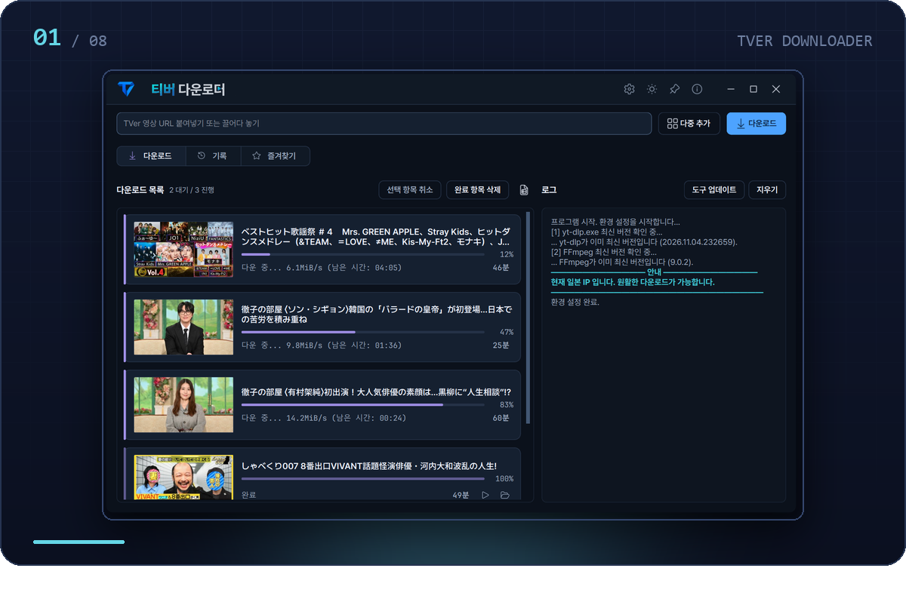</a>

A PyQt6 desktop app that saves TVer episodes, and YouTube videos, through yt-dlp and FFmpeg, built around a resumable, series-aware download queue.

- Single, multi-URL and whole-series downloads with 1–20 concurrent jobs and parallel fragment fetching
- Keeps yt-dlp and FFmpeg up to date; optional AVC / HEVC re-encoding with NVIDIA NVENC
- Japanese subtitles embedded or saved as VTT / SRT; favorites, history and tray progress
- Region check that re-runs when the network changes, and 7 UI languages that switch without a restart

<b>Stack</b>&nbsp; `Python` `PyQt6` `yt-dlp` `FFmpeg` `NVENC` 
<b>Distribution</b>&nbsp; [Freeware (personal, non-commercial use)](https://github.com/deuxdoom/TVerDownloader#license) · source not published · Windows&nbsp;10/11&nbsp;x64 
<b>Latest</b>&nbsp; 

  

 

### 02 · ChzzkDownloader

**Multi-site video downloader built around CHZZK**

<a href="https://github.com/deuxdoom/ChzzkDownloader">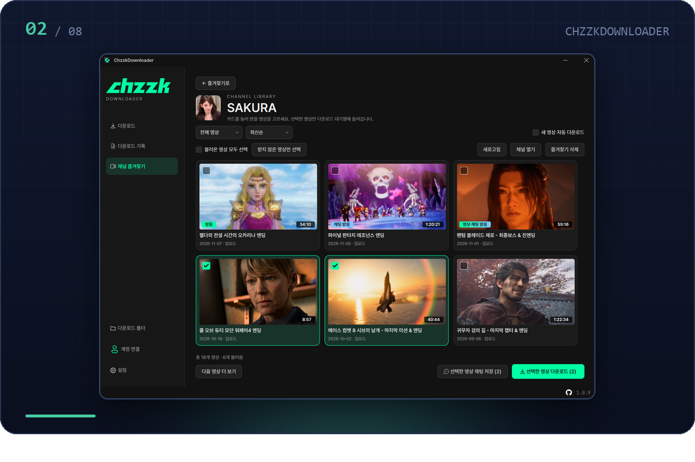</a>

Saves CHZZK VODs and clips, as well as YouTube, Instagram, TVer and other supported sites, as MP4, with channel-centric browsing for CHZZK.

- Batch queue with up to 4 videos at once and 16 fragments per video, restored across restarts
- Channel favorites with thumbnail browsing; followed channels imported from a linked account
- Cookie-based account linking with encrypted local storage (no ID or password entry) and multiple profiles
- Keeps the original by default, with optional H.264 / H.265 on CPU or NVENC, and SHA-256 verified self-updates

<b>Stack</b>&nbsp; `Python` `PySide6` `yt-dlp` `FFmpeg` `NVENC` 
<b>Distribution</b>&nbsp; [Freeware (personal, non-commercial use)](https://github.com/deuxdoom/ChzzkDownloader#license) · source not published · Windows&nbsp;10/11&nbsp;x64 
<b>Latest</b>&nbsp; 

  

 

### 03 · PICVIUM

**Image viewer and editor with RAW support and local upscaling**

<a href="https://github.com/deuxdoom/PICVIUM">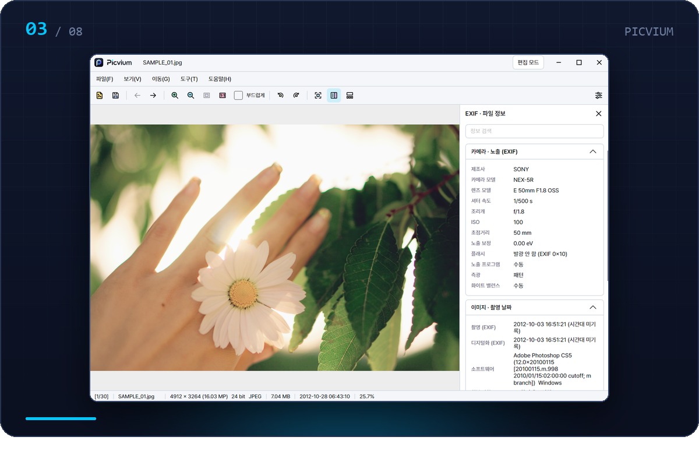</a>

Views photos, graphics, camera RAW files and document images in one window, with local editing, format conversion and Real-ESRGAN upscaling. The Windows release includes its .NET runtime and supports portable settings.

- Folder thumbnails, zoom and pan, animation playback, multipage navigation and an EXIF sidebar
- Crop, resize, rotate and flip with undo / redo; save or batch-convert to seven image formats
- Photo and illustration upscaling at 2×, 4× or 8× on a Vulkan GPU, with cancellation and result comparison
- Customizable toolbar and icon themes, command search, Windows file associations and 9 UI languages that switch without a restart

<b>Stack</b>&nbsp; `C#` `.NET 10` `Avalonia 12` `Magick.NET` `LibRaw` `PDFium` `Real-ESRGAN / Vulkan` 
<b>Distribution</b>&nbsp; [Freeware (personal, non-commercial use)](https://github.com/deuxdoom/PICVIUM#license) · source not published · Windows&nbsp;10/11&nbsp;x64 
<b>Latest</b>&nbsp; 

  

 

### 04 · FrameDoubler

**Smooth capture-card gameplay on Windows, live and in recordings**

<a href="https://github.com/deuxdoom/FrameDoubler">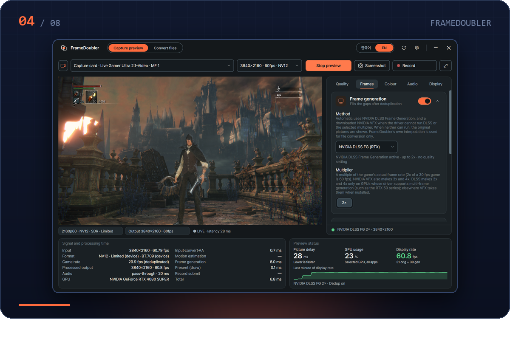</a>

Shows and records console gameplay from a capture card with real-time frame generation, and turns recordings whose 60 fps files only move at 30 fps into true 60 fps motion with RIFE interpolation.

- Removes duplicate frames first to recover the real motion, then interpolates with Practical-RIFE 4.25 / 4.26 on ncnn and Vulkan, leaving scene cuts and still screens untouched
- Live preview uses NVIDIA DLSS frame generation first and falls back to NVIDIA VFX (up to 4×), with SMAA anti-aliasing and HDR-to-SDR tone mapping
- Encoders confirmed by a short real encode (NVENC, AMF, QSV or software; H.264, HEVC, AV1), YouTube presets and optional sync verification
- Time estimate from a short trial run, a batch queue, a command-line tool and SHA-256 verified updates that roll back on failure

<b>Stack</b>&nbsp; `C#` `.NET 10` `WPF` `C++` `RIFE` `ncnn / Vulkan` `FFmpeg` 
<b>Distribution</b>&nbsp; [Open source (MIT)](https://github.com/deuxdoom/FrameDoubler#license) · source published · Windows&nbsp;11&nbsp;x64 
<b>Latest</b>&nbsp; 

  

 

### 05 · GamePadTester

**Precision gamepad diagnostics for Windows**

<a href="https://github.com/deuxdoom/GamePadTester">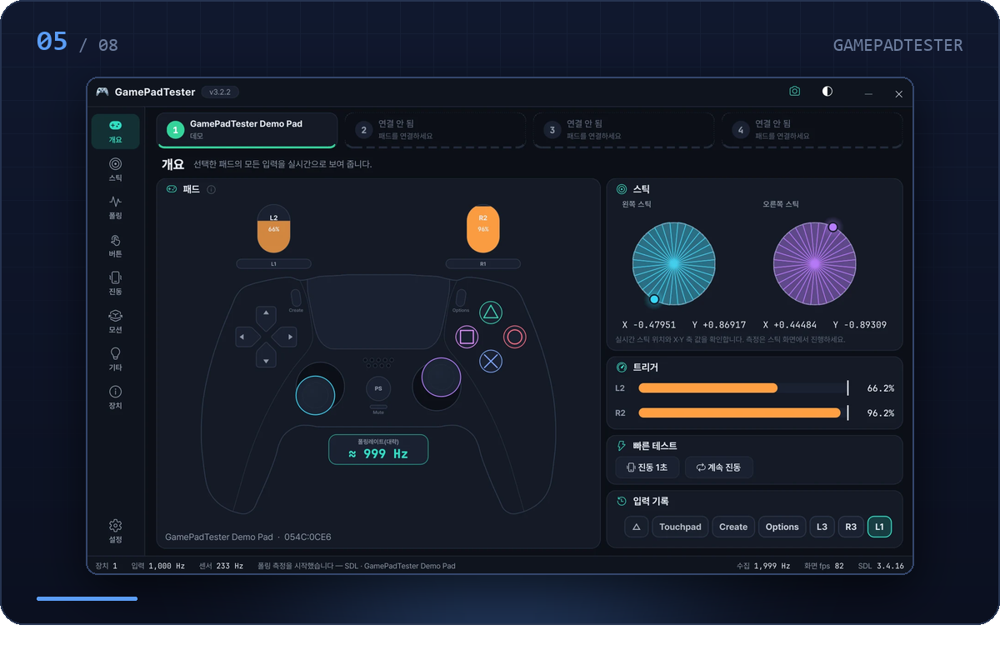</a>

Measures stick circularity and polling rate with the same methods as gamepad-tester.com and Gamepadla, so results compare directly, and checks buttons, triggers, haptics, gyro and touchpad.

- Stick circularity (RMS error over 32 sectors), drift, resolution and snapback, measured on raw values without an imposed deadzone
- Polling rate timed on a dedicated C++ thread from XInput packets, raw HID reports or SDL, exportable as JSON, CSV or TXT
- Up to four controllers, with layouts for Xbox, DualSense and Switch Pro / ProCon 2, plus adaptive-trigger and rumble tests
- One-click 1000 Hz USB polling for DualSense, 800×400 result cards and SHA-256 verified updates

<b>Stack</b>&nbsp; `Python` `PySide6` `C++20` `SDL3` `XInput` `HID` 
<b>Distribution</b>&nbsp; [Freeware (personal and business use)](https://github.com/deuxdoom/GamePadTester#license) · source not published · Windows&nbsp;10/11 
<b>Latest</b>&nbsp; 

  

 

### 06 · SteamSlice

**Animated Steam profile showcases from a GIF or video**

<a href="https://github.com/deuxdoom/SteamSlice">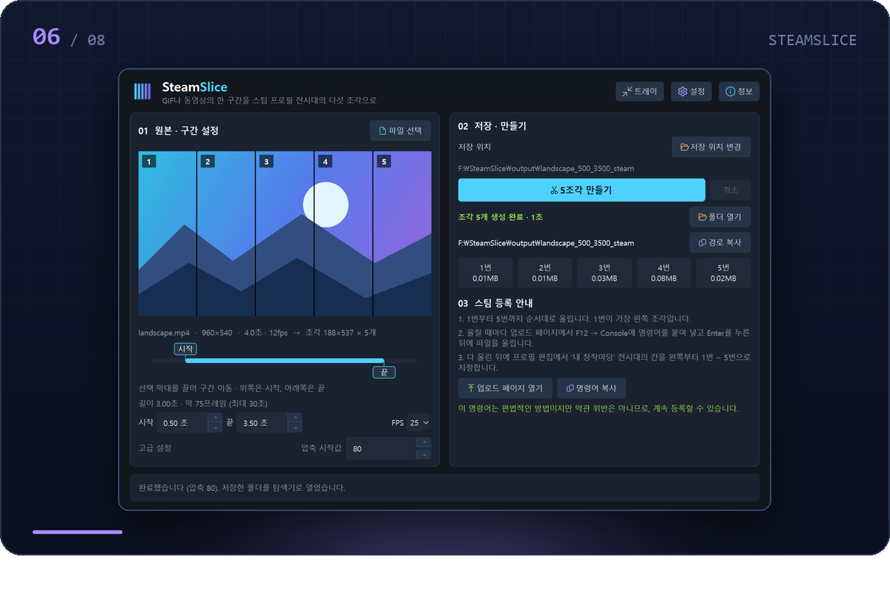</a>

Cuts a GIF or a video clip into five animated slices that run across the five panels of a Steam profile Workshop showcase. All media processing happens on the local PC.

- GIF, MP4, MKV, MOV, WebM and more up to 4K; video ranges of 0.2–30 s picked on a draggable timeline, at 25, 20 or 10 fps
- Five 188 px slices with 4 px gaps (188×537 for 16:9), each compressed with Gifsicle to 5,000,000 bytes or less
- Upload guide that opens Steam's artwork page and copies the console command; you upload slices 1 → 5 yourself
- Light and dark themes, tray, single instance, and SHA-256 verified updates that restore the previous files on failure

<b>Stack</b>&nbsp; `Python` `PyQt6` `Gifsicle` `FFmpeg` `PyInstaller` 
<b>Distribution</b>&nbsp; [Open source (GPL-3.0)](https://github.com/deuxdoom/SteamSlice#license) · source published · Windows&nbsp;10/11&nbsp;x64 
<b>Latest</b>&nbsp; 

  

 

### 07 · ShadowPlay Notifier

**Recording status display for a second monitor**

<a href="https://github.com/deuxdoom/Shadowplay-Notifier">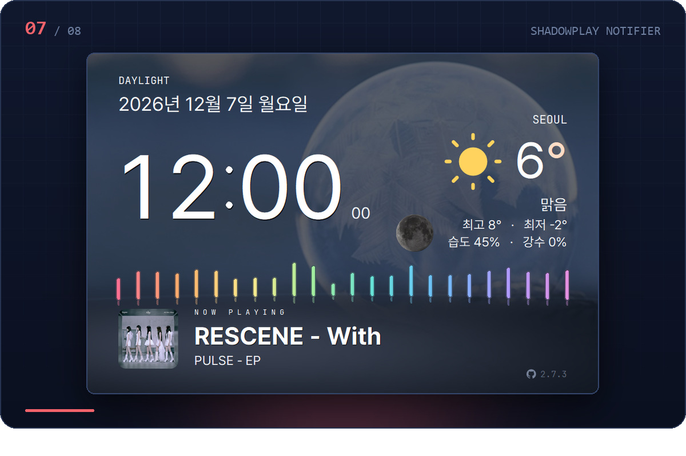</a>

Shows NVIDIA ShadowPlay recording status in large type on a secondary monitor, and turns into a clock, weather and now-playing wallpaper while idle.

- Detects recording by watching file growth and write handles in the capture folder: read-only, with no hooks into the recorder
- Elapsed time, file size, bitrate and file name, updated within one polling interval (0.5 s by default)
- Idle wallpaper with clock, Open-Meteo weather, Spotify now-playing, a 24-band audio visualizer and the moon phase
- Single portable EXE that pauses rendering while hidden in the tray, with SHA-256 checked in-app updates

<b>Stack</b>&nbsp; `Python` `Tkinter` `PyInstaller` `Open-Meteo` 
<b>Distribution</b>&nbsp; [Freeware (personal and business use)](https://github.com/deuxdoom/Shadowplay-Notifier#license) · source not published · Windows&nbsp;10/11 
<b>Latest</b>&nbsp; 

  

 

### 08 · AI Agents Usage Monitor

**Claude and Codex usage limits in the Windows tray**

<a href="https://github.com/deuxdoom/usage-monitor-for-claude">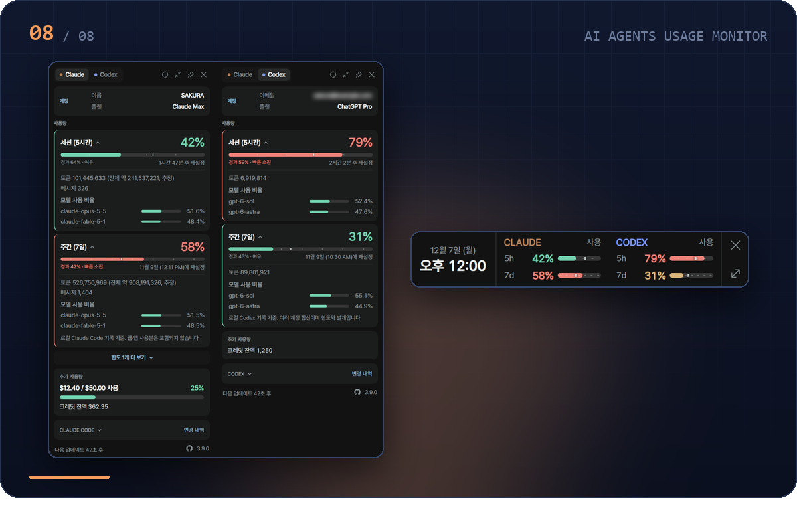</a>

A lightweight tray app that shows Claude and Codex usage limits in real time. It is an extended fork of [jens-duttke/usage-monitor-for-claude](https://github.com/jens-duttke/usage-monitor-for-claude) that adds Codex support, a one-line bar mode and a verified in-app updater.

- Live tray icon for session and weekly limits; detail popup with reset times, plan, credits and per-model token breakdowns from local session logs
- Codex limits read through the official Codex App Server, side by side with Claude
- One-line bar mode next to the clock, time-aware usage colors and threshold alerts
- Portable single EXE, 13 languages, event commands and an in-app updater with rollback

<b>Stack</b>&nbsp; `Python` `pywebview` `pystray` `PyInstaller` `C#` 
<b>Distribution</b>&nbsp; [Open source (MIT)](https://github.com/deuxdoom/usage-monitor-for-claude#license) · source published · Windows&nbsp;10/11&nbsp;x64 
<b>Latest</b>&nbsp; 

  

 

TVer, CHZZK, NVIDIA ShadowPlay, NVIDIA DLSS, DualSense, Steam, Claude and Codex are trademarks of their respective owners. These are independent projects, not affiliated with or endorsed by them.

## 04 · Engineering Toolbox

Technologies that ship in the releases above, grouped by area. The numbers refer to the Featured projects.

| Area | Stack |
|:--|:--|
| **Languages** |     Python 01, 02, 05–08 · C# 03, 04, 08 · C++ frame engine 04 and C++20 measurement core 05 · JavaScript / HTML / CSS for project sites and the 08 popup UI |
| **Desktop & runtime** |         PySide6 02, 05 · PyQt6 01, 06 · Tkinter 07 · Avalonia 12 on .NET 10 03 · WPF on .NET 10 04 · pywebview and pystray 08 · PyInstaller packaging 06–08 |
| **Media & imaging** |           FFmpeg 01, 02, 04, 06 · yt-dlp 01, 02 · NVENC hardware encoding 01, 02, 04 · RIFE on ncnn / Vulkan and NVIDIA DLSS / VFX frame generation 04 · Real-ESRGAN / Vulkan, Magick.NET, LibRaw and PDFium 03 · Gifsicle 06 |
| **Input & hardware** |    Controller input, polling-rate timing and haptics in 05 · capture-card input through Media Foundation / DirectShow in 04 |
| **Delivery & workflow** |      Every app ships through GitHub Releases with a GitHub Pages site · GitHub Actions refreshes the data on this profile |

## 05 · GitHub Activity & Insights

  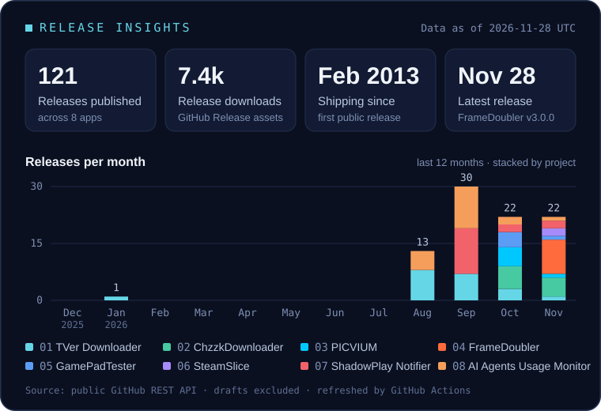

Generated from the public GitHub REST API by a scheduled workflow (<a href=".github/workflows/refresh-data.yml">refresh-data.yml</a>). Download counts cover GitHub Release assets only.

## 06 · Latest Software Releases

| Project | Latest stable release · date (UTC) |
|:--|:--|
| **01 · [TVer Downloader](https://github.com/deuxdoom/TVerDownloader)** |  |
| **02 · [ChzzkDownloader](https://github.com/deuxdoom/ChzzkDownloader)** |  |
| **03 · [PICVIUM](https://github.com/deuxdoom/PICVIUM)** |  |
| **04 · [FrameDoubler](https://github.com/deuxdoom/FrameDoubler)** |  |
| **05 · [GamePadTester](https://github.com/deuxdoom/GamePadTester)** |  |
| **06 · [SteamSlice](https://github.com/deuxdoom/SteamSlice)** |  |
| **07 · [ShadowPlay Notifier](https://github.com/deuxdoom/Shadowplay-Notifier)** |  |
| **08 · [AI Agents Usage Monitor](https://github.com/deuxdoom/usage-monitor-for-claude)** |  |

Read from each repository's GitHub Releases: the newest published release that is not a draft or pre-release. A newer pre-release, if one exists, appears as an extra segment, and a project without a release shows “No published release”. Refreshed every six hours.

## 07 · Engineering in Practice

Selected implementation decisions from the shipped applications: how input is measured, where images are processed, and how desktop updates recover from failure.

<picture>
  <source media="(max-width: 640px)" srcset="assets/engineering-compact.svg">
  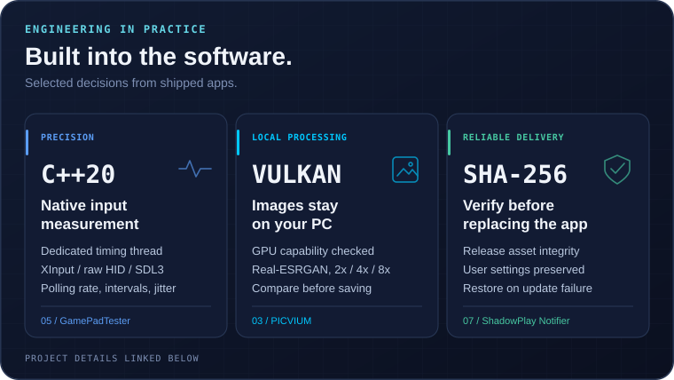
</picture>

**Project details** · [Native controller measurement](https://github.com/deuxdoom/GamePadTester/blob/main/readme.md) · [Local image processing](https://github.com/deuxdoom/PICVIUM/blob/main/README.md) · [Verified updates and recovery](https://github.com/deuxdoom/Shadowplay-Notifier/blob/main/README.md)

<picture>
  <source media="(max-width: 640px)" srcset="assets/update-flow-compact.svg">
  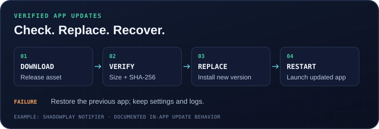
</picture>

The update flow shows the documented behavior of ShadowPlay Notifier. The highlights above describe specific projects; implementation details are linked in their READMEs.

## 08 · Connect

- **GitHub** · [@deuxdoom](https://github.com/deuxdoom) · [all repositories](https://github.com/deuxdoom?tab=repositories)
- **Mastodon** · [@deuxdoom@mastodon.social](https://mastodon.social/@deuxdoom)
- **Support** · [GitHub Sponsors](https://github.com/sponsors/deuxdoom)
- **Feedback** · Bug reports and feature requests are welcome in each project's Issues tab.

**Project sites** · [TVer Downloader](https://deuxdoom.github.io/TVerDownloader/) · [ChzzkDownloader](https://deuxdoom.github.io/ChzzkDownloader/) · [PICVIUM](https://deuxdoom.github.io/PICVIUM/) · [FrameDoubler](https://deuxdoom.github.io/FrameDoubler/) · [GamePadTester](https://deuxdoom.github.io/GamePadTester/) · [SteamSlice](https://deuxdoom.github.io/SteamSlice/) · [ShadowPlay Notifier](https://deuxdoom.github.io/Shadowplay-Notifier/) · [AI Agents Usage Monitor](https://deuxdoom.github.io/usage-monitor-for-claude/)

 

<a href="#top">Back to top ↑</a>

