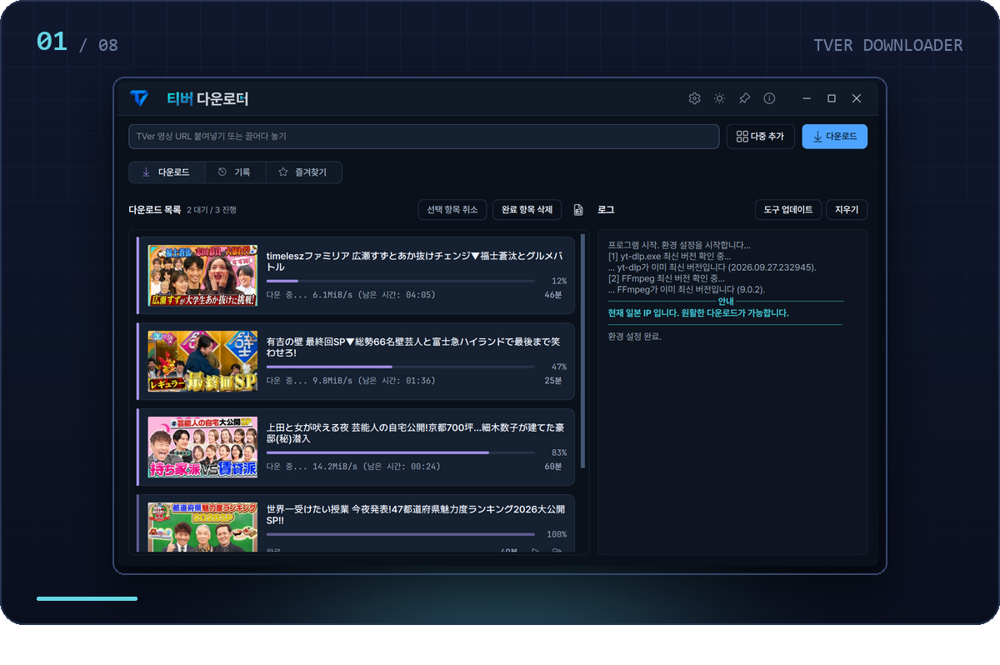
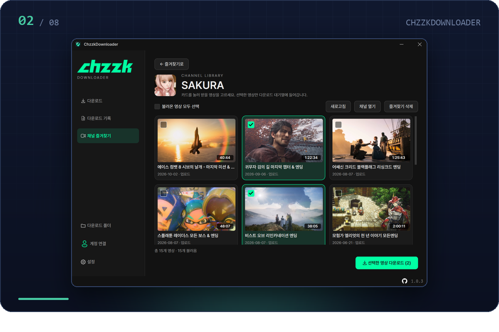
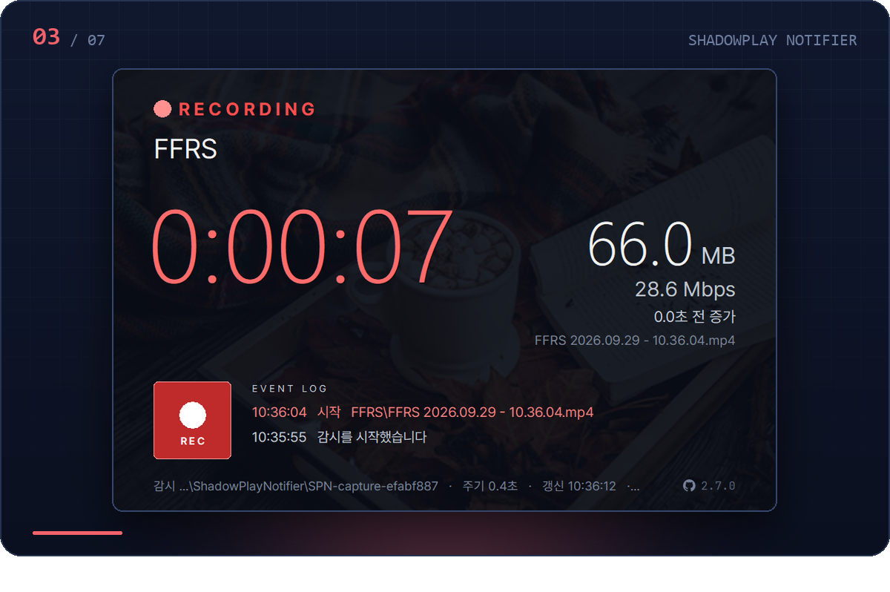
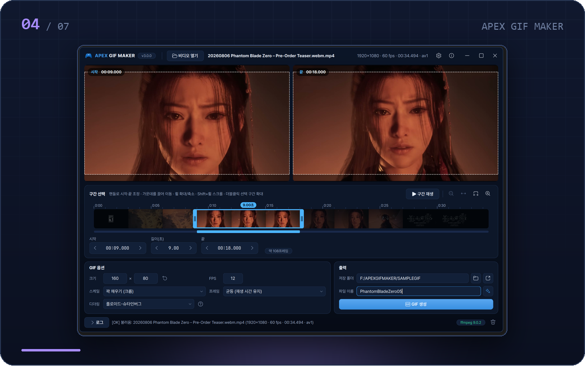
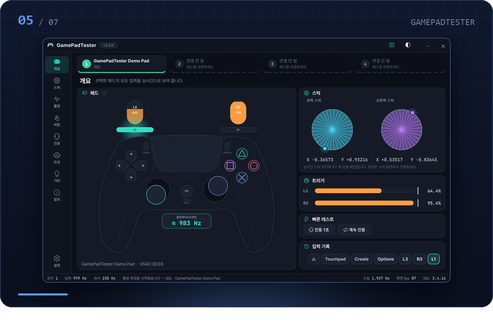
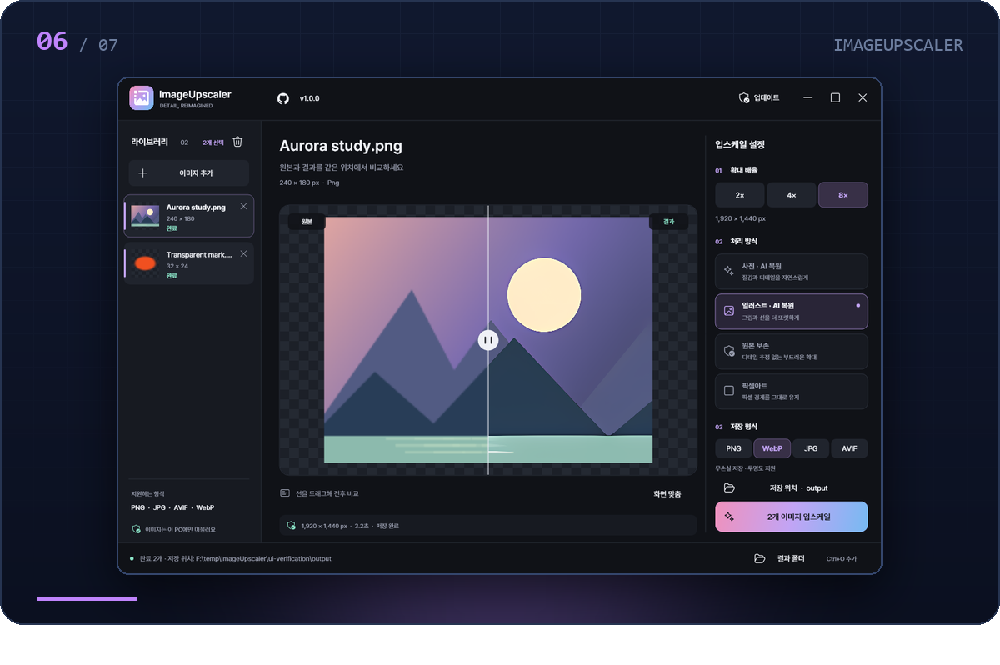
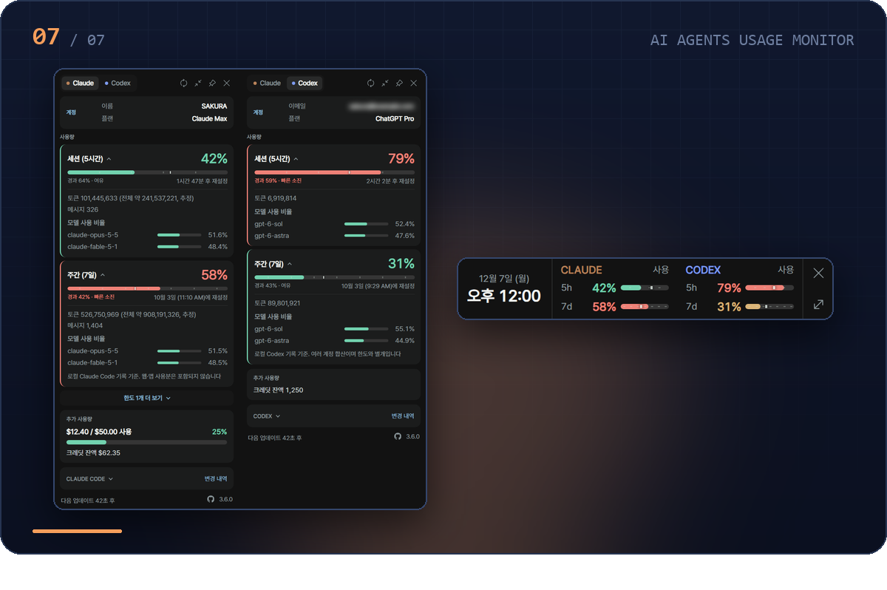
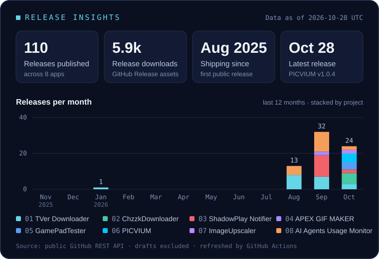

<picture>
  <source media="(max-width: 640px)" srcset="assets/hero-compact.svg">
  
</picture>

 

  <a href="#about"><b>About</b></a> &nbsp;·&nbsp;
  <a href="#software"><b>Software</b></a> &nbsp;·&nbsp;
  <a href="#toolbox"><b>Toolbox</b></a> &nbsp;·&nbsp;
  <a href="#insights"><b>Insights</b></a> &nbsp;·&nbsp;
  <a href="#releases"><b>Releases</b></a> &nbsp;·&nbsp;
  <a href="#connect"><b>Connect</b></a>

## 02 · About

I build practical desktop applications and developer utilities, focusing on reliable functionality, thoughtful interfaces, and everyday usability.

I work independently and take each app from design through implementation, debugging, release and maintenance. Since August 2025 that has produced seven Windows applications, from media downloaders and a GIF tool for controller screens to hardware diagnostics, an image upscaler and tray utilities. Each one ships through GitHub Releases with its own project site, a changelog and a built-in updater.

| Principle | How it shows up in the software |
|:--|:--|
| **Usability** | Sensible defaults, drag-and-drop input, and localized interfaces (up to 13 languages) |
| **Reliability** | SHA-256 verified in-app updates with rollback, and failures that are reported instead of silently papered over |
| **Performance** | GPU paths where they matter (NVENC, Vulkan), a dedicated C++ timing thread for polling-rate tests, and measured UI work such as a history search cut from 1,143 ms to 56 ms |
| **Maintainability** | Portable apps with documented settings and backup files, and a changelog kept for every project |
| **Iterative improvement** | Small, frequent releases shaped by real use and issue reports, visible in the [release activity](#insights) below |

## 03 · Featured Software

Seven Windows applications, numbered in priority order. Six are free, closed-source releases whose repositories hold documentation, changelogs and binaries; one is an open-source (MIT) fork.

### 01 · TVer Downloader

**Windows downloader for Japan's TVer streaming service**

A PyQt6 desktop app that saves TVer episodes, and YouTube videos, through yt-dlp and FFmpeg, built around a resumable, series-aware download queue.

- Single, multi-URL and whole-series downloads with 1–20 concurrent jobs and parallel fragment fetching
- Keeps yt-dlp and FFmpeg up to date; optional AVC / HEVC re-encoding with NVIDIA NVENC
- Japanese subtitles embedded or saved as VTT / SRT; favorites, history and tray progress
- Region check that re-runs when the network changes, and 7 UI languages that switch without a restart

<b>Stack</b>&nbsp; `Python` `PyQt6` `yt-dlp` `FFmpeg` `NVENC` 
<b>Distribution</b>&nbsp; Freeware · Windows 10/11 x64 · source not published 
<b>Latest</b>&nbsp; 

  

 

### 02 · ChzzkDownloader

**Multi-site video downloader built around CHZZK**

Saves CHZZK VODs and clips, as well as YouTube, Instagram, TVer and other supported sites, as MP4, with channel-centric browsing for CHZZK.

- Batch queue with up to 4 videos at once and 16 fragments per video, restored across restarts
- Channel favorites with thumbnail browsing; followed channels imported from a linked account
- Cookie-based account linking with encrypted local storage (no ID or password entry) and multiple profiles
- Keeps the original by default, with optional H.264 / H.265 on CPU or NVENC, and SHA-256 verified self-updates

<b>Stack</b>&nbsp; `Python` `PySide6` `yt-dlp` `FFmpeg` `NVENC` 
<b>Distribution</b>&nbsp; Free for personal use · Windows 10/11 x64 · source not published 
<b>Latest</b>&nbsp; 

  

 

### 03 · ShadowPlay Notifier

**Recording status display for a second monitor**

Shows NVIDIA ShadowPlay recording status in large type on a secondary monitor, and turns into a clock, weather and now-playing wallpaper while idle.

- Detects recording by watching file growth and write handles in the capture folder: read-only, with no hooks into the recorder
- Elapsed time, file size, bitrate and file name, updated within one polling interval (0.5 s by default)
- Idle wallpaper with clock, Open-Meteo weather, Spotify now-playing, a 24-band audio visualizer and the moon phase
- Single portable EXE that pauses rendering while hidden in the tray, with SHA-256 checked in-app updates

<b>Stack</b>&nbsp; `Python` `Tkinter` `PyInstaller` `Open-Meteo` 
<b>Distribution</b>&nbsp; Freeware · Windows 10/11 · source not published 
<b>Latest</b>&nbsp; 

  

 

### 04 · APEX GIF MAKER

**MP4-to-GIF studio for Flydigi APEX controller screens**

Turns a moment from any video into an animated GIF sized for the built-in screen of Flydigi APEX-series controllers such as the APEX 4, 5 and 6, processed entirely on the local PC.

- Precise range selection with trim handles, a zoomable timeline and typed timestamps
- Screen-ready output: 160×80 at 12 fps by default, with fill, letterbox or stretch scaling and a crop preview
- GIF quality controls: adaptive palette, dithering, and uniform or duplicate-dropping frame modes
- Auto-managed FFmpeg, SHA-256 verified updates, 6 UI languages and dark / light themes

<b>Stack</b>&nbsp; `Python` `PySide6` `FFmpeg` 
<b>Distribution</b>&nbsp; Freeware · Windows 10/11 x64 · source not published 
<b>Latest</b>&nbsp; 

  

 

### 05 · GamePadTester

**Precision gamepad diagnostics for Windows**

Measures stick circularity and polling rate with the same methods as gamepad-tester.com and Gamepadla, so results compare directly, and checks buttons, triggers, haptics, gyro and touchpad.

- Stick circularity (RMS error over 32 sectors), drift, resolution and snapback, measured on raw values without an imposed deadzone
- Polling rate timed on a dedicated C++ thread from XInput packets, raw HID reports or SDL, exportable as JSON, CSV or TXT
- Up to four controllers, with layouts for Xbox, DualSense and Switch Pro / ProCon 2, plus adaptive-trigger and rumble tests
- One-click 1000 Hz USB polling for DualSense, 800×400 result cards and SHA-256 verified updates

<b>Stack</b>&nbsp; `Python` `PySide6` `C++20` `SDL3` `XInput` `HID` 
<b>Distribution</b>&nbsp; Freeware · Windows 10/11 · source not published 
<b>Latest</b>&nbsp; 

  

 

### 06 · ImageUpscaler

**Portable, offline AI image upscaler**

Enlarges photos, illustrations, transparent images and pixel art up to 8× on the local PC. One portable EXE bundles the Real-ESRGAN models, codecs and runtime.

- Four modes: Photo AI (Real-ESRGAN x4plus), Image AI (x4plus-anime), linear-light Lanczos, and integer nearest-neighbor for pixel art
- PNG, JPG, WebP and AVIF at 2×, 4× or 8×, with alpha preserved and scaled separately
- Batch list with a before / after comparison slider and zoom
- Vulkan capability check with explicit fallbacks, and SHA-256 verified updates

<b>Stack</b>&nbsp; `C#` `.NET 8` `Windows Forms` `SkiaSharp` `Magick.NET` `Real-ESRGAN (ncnn / Vulkan)` 
<b>Distribution</b>&nbsp; Free download · Windows 10/11 x64 · source not published 
<b>Latest</b>&nbsp; 

  

 

### 07 · AI Agents Usage Monitor

**Claude and Codex usage limits in the Windows tray**

A lightweight tray app that shows Claude and Codex usage limits in real time. It is an extended fork of [jens-duttke/usage-monitor-for-claude](https://github.com/jens-duttke/usage-monitor-for-claude) that adds Codex support, a one-line bar mode and a verified in-app updater.

- Live tray icon for session and weekly limits; detail popup with reset times, plan, credits and per-model token breakdowns from local session logs
- Codex limits read through the official Codex App Server, side by side with Claude
- One-line bar mode next to the clock, time-aware usage colors and threshold alerts
- Portable single EXE, 13 languages, event commands and an in-app updater with rollback

<b>Stack</b>&nbsp; `Python` `pywebview` `pystray` `PyInstaller` `C#` 
<b>Distribution</b>&nbsp; Open source (MIT) · fork of jens-duttke/usage-monitor-for-claude · Windows 10/11 x64 
<b>Latest</b>&nbsp; 

  

 

TVer, CHZZK, NVIDIA ShadowPlay, Flydigi APEX, DualSense, Claude and Codex are trademarks of their respective owners. These are independent projects, not affiliated with or endorsed by them.

## 04 · Engineering Toolbox

Technologies that ship in the releases above, grouped by area. The numbers refer to the Featured projects.

| Area | Stack |
|:--|:--|
| **Languages** |     Python 01–05, 07 · C# 06, 07 · C++20 measurement core 05 · JavaScript / HTML / CSS for project sites and the 07 popup UI |
| **Desktop & runtime** |        PySide6 02, 04, 05 · PyQt6 01 · Tkinter 03 · Windows Forms on .NET 8 06 · pywebview and pystray 07 · single-EXE builds with PyInstaller 03, 07 |
| **Media & imaging** |        FFmpeg 01, 02, 04 · yt-dlp 01, 02 · NVENC hardware encoding 01, 02 · Real-ESRGAN through ncnn / Vulkan, SkiaSharp and Magick.NET 06 |
| **Input & hardware** |    Controller input, polling-rate timing and haptics in 05 |
| **Delivery & workflow** |      Every app ships through GitHub Releases with a GitHub Pages site and an in-app updater · GitHub Actions refreshes the data on this profile |

## 05 · GitHub Activity & Insights

  

Generated from the public GitHub REST API by a scheduled workflow (<a href=".github/workflows/refresh-data.yml">refresh-data.yml</a>). Download counts cover GitHub Release assets only.

## 06 · Latest Software Releases

| Project | Latest stable release · date (UTC) |
|:--|:--|
| **01 · [TVer Downloader](https://github.com/deuxdoom/TVerDownloader)** |  |
| **02 · [ChzzkDownloader](https://github.com/deuxdoom/ChzzkDownloader)** |  |
| **03 · [ShadowPlay Notifier](https://github.com/deuxdoom/Shadowplay-Notifier)** |  |
| **04 · [APEX GIF MAKER](https://github.com/deuxdoom/APEXGIFMAKER)** |  |
| **05 · [GamePadTester](https://github.com/deuxdoom/GamePadTester)** |  |
| **06 · [ImageUpscaler](https://github.com/deuxdoom/ImageUpscaler)** |  |
| **07 · [AI Agents Usage Monitor](https://github.com/deuxdoom/usage-monitor-for-claude)** |  |

Read from each repository's GitHub Releases: the newest published release that is not a draft or pre-release. A newer pre-release, if one exists, appears as an extra segment, and a project without a release shows “No published release”. Refreshed every six hours.

## 07 · Connect

- **GitHub** · [@deuxdoom](https://github.com/deuxdoom) · [all repositories](https://github.com/deuxdoom?tab=repositories)
- **Mastodon** · [@deuxdoom@mastodon.social](https://mastodon.social/@deuxdoom)
- **Support** · [GitHub Sponsors](https://github.com/sponsors/deuxdoom)
- **Feedback** · Bug reports and feature requests are welcome in each project's Issues tab.

**Project sites** · [TVer Downloader](https://deuxdoom.github.io/TVerDownloader/) · [ChzzkDownloader](https://deuxdoom.github.io/ChzzkDownloader/) · [ShadowPlay Notifier](https://deuxdoom.github.io/Shadowplay-Notifier/) · [APEX GIF MAKER](https://deuxdoom.github.io/APEXGIFMAKER/) · [GamePadTester](https://deuxdoom.github.io/GamePadTester/) · [ImageUpscaler](https://deuxdoom.github.io/ImageUpscaler/) · [AI Agents Usage Monitor](https://deuxdoom.github.io/usage-monitor-for-claude/)

 

<a href="#top">Back to top ↑</a>

